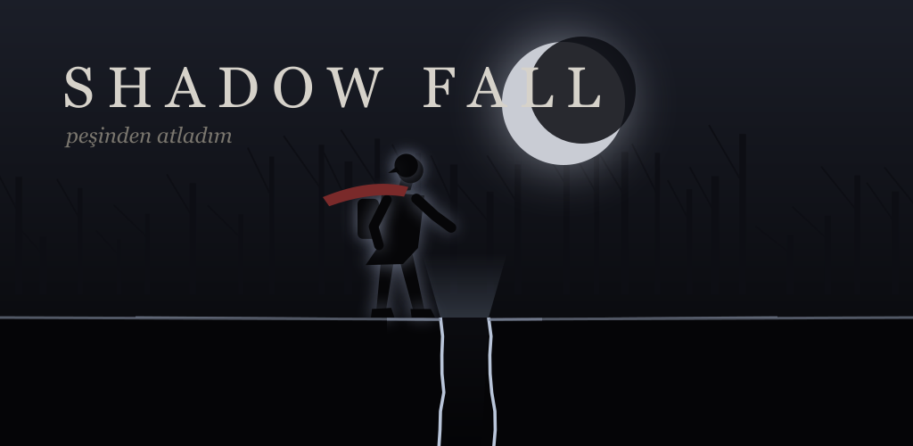

# Shadow Fall

Atmospheric black-and-white silhouette puzzle-platformer for Android.
The ground splits open on an evening walk, Maria falls into the fissure and Kai jumps after her —
100 chapters of physics puzzles, creatures and escapes between him and the light at the bottom.



## Highlights

- **A puzzle in every chapter** — raise a canal by swimming under a bulkhead to its valve, drive a raft with
  communicating vessels and a pushed crate, balance a counterweight lift, hold heavy doors with pressure plates,
  wake light sensors with the flashlight, beat timed gates.
- **Buildings** — two-storey houses with real staircases, and complexes that last two or three chapters
  (hospital, foundry, water treatment plant, barracks, library...). Indoors only the interior is visible.
- **Six creature types** with different senses: root stalker, hound, lurker, blind crawler (hears vibration),
  wraith (only stopped by light), brute (charges until it hits a wall). Chases span the whole reachable area.
- **Systemic wildfire** — lightning ignites a tree, fire spreads from tree to grass along the wind, embers start
  spot fires, burning trees fall.
- **Adaptive score** — 18 procedurally synthesised but composed pieces (per-act exploration themes, interior,
  stealth, puzzle, chase, escape, vehicle, bomb) cross-faded by a music director.
- **Hiding places, not loot boxes** — drawers, wardrobes, first-aid cabinets, lockers, tree hollows, glove boxes...
  Bandages only come from medical places.
- Skeletal IK character animation, dynamic 2D lighting, gesture-only touch controls, fully offline.

## Tech

| | |
|---|---|
| Engine | Phaser 3.60 (Matter.js physics), all art drawn procedurally at runtime |
| Audio | Web Audio API synthesis — no audio files |
| Platform | Capacitor 8 Android shell (immersive landscape), min SDK 24, target SDK 36 |
| Tests | Node level-generation suite + headless Chrome gameplay checks (Puppeteer) |

```
index.html          app shell, HUD and menus
js/
  main.js           game scene, player controller, camera, UI
  levelgen.js       deterministic 100-chapter generator
  puzzles.js        canal / hydraulic / pulley / pressure / photocell / timed-gate puzzles
  buildings.js      houses, multi-chapter interiors, stairs, interior visibility
  missions.js       set pieces: wildfire, flood, colossus, vehicle escapes, bomb
  creatures.js      creature and soldier AI
  human.js          IK character rig and animation
  items.js          physics items, hiding places, doors, levers, ladders
  music.js          adaptive music director
  audio.js          procedural sound effects and ambience
  physics.js        water, wind, light system
  atmosphere.js     parallax, weather, screen effects
scripts/            web build, icon / store art generator
tests/              level generation, smoke and gameplay tests
android/            Capacitor Android project
docs/               privacy policy, Play Store release kit
```

## Development

```bash
npm install
npm run serve            # http://localhost:8765
npm test                 # generate and validate all 100 chapters
npm run test:play        # scripted gameplay checks in headless Chrome
npm run android:sync     # build www/ and copy into the Android project
cd android && ./gradlew bundleRelease
```

Release signing reads `android/keystore.properties` (not committed). See [docs/PLAY_STORE.md](docs/PLAY_STORE.md).

## Privacy

The game collects no personal data. See [kvkk.txt](kvkk.txt) and [docs/privacy-policy.html](docs/privacy-policy.html).

---

© 2026 Ahmet Yaz · [Yazify](https://www.yazify.net) · yzz_software@hotmail.com
